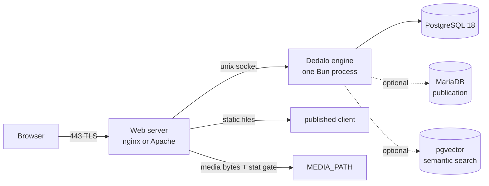

# Installation

> See also: [Installer reference](installer_reference.md) · [Production install](production.md) · [Docker](docker.md) · [Configuration](../config/index.md)

Dédalo manages cultural heritage: archaeological, ethnological and documentary collections, memory and oral history. It is a client–server application, so installing it means preparing a server. One installer does it, in the terminal, whatever kind of server you choose.

## What you are installing



Four moving parts, and it is worth knowing which is which before you start:

- **The engine** — a single long-lived process on the Bun runtime. It listens on a **unix socket**, never on a TCP port in production.
- **PostgreSQL** — the system of record. Everything is in it: the ontology, the records, the users, the audit trail.
- **The web server** — owns TCP and TLS, serves the client files, and **enforces media access control** using rule files the engine generates. It is not optional.
- **The media tree** — an absolute path, usually on its own volume. Originals plus every derivative. It is the largest thing you will store, and the only one no database backup can reconstruct.

Everything else — publication to a public website, semantic search, the AI assistant — is optional and off by default.

## Get Dédalo

The Production route installs from a **release archive**; the Docker, Trial and Developer routes run from a **git checkout**.

| You need | Where it is |
| --- | --- |
| a release archive (Production) | the official code server publishes each release at `https://v7.master.dedalo.dev/dedalo/install/code/<version>/<version>.zip`, and its sha256 beside it, at the same address with `.sha256` added. The releases are also listed at `https://github.com/dedalia-org/dedalo/releases` |
| a checkout (Docker, Trial, Developer) | `git clone https://github.com/dedalia-org/dedalo.git`, then `git checkout v<version>` for a release. Keep the git remote: a Docker update builds from the release's tag |

Unpack the archive and run `install.sh` from it, or let the bootstrap fetch and check it for you:

```shell
sudo sh install.sh --release https://v7.master.dedalo.dev/dedalo/install/code/<version>/<version>.zip \
  --release-sha256 <sha256>
```

`<sha256>` is the digest published in `<version>.zip.sha256`. The bootstrap hashes the archive before anything reads it and refuses it when the hash differs.

The bootstrap itself needs `curl`, `unzip` and `sha256sum` on the machine before the installer can install anything. A minimal server may lack them:

```shell
sudo apt-get install curl unzip coreutils     # Debian, Ubuntu
sudo dnf install curl unzip coreutils         # RHEL, Rocky Linux, AlmaLinux
```

## One command

Every install starts the same way, from the release (or the checkout) of Dédalo:

```shell
sudo sh install.sh        # production: it changes the host, so it runs as root
sh install.sh             # docker, trial and developer: as yourself
```

`install.sh` is only the bootstrap: it checks the machine, verifies the release and the pinned Bun runtime, and then starts the installer (`scripts/install.ts`). The installer asks its questions on full-screen terminal screens (`--plain` for one question per line), shows the whole plan — every command it will run on the host — on a Review screen, and only then installs. Every flag, the answers file, resume and abort are in the [installer reference](installer_reference.md).

There is no browser installer. A server on a machine that is not installed refuses to start (exit code `78`).

## Choose a route

The first screen asks how this Dédalo will run. The route decides the rest of the questions and what the installer does to the machine.

| Route | For | What it sets up | Media protection | TLS | Start here |
| --- | --- | --- | --- | --- | --- |
| **Production** | a museum, archive or institution: the recommended route | native services on this host — packages, PostgreSQL 18, a named instance user, systemd units, nginx or Apache, the certificate, backups, a watchdog | yes, enforced by the web server | Let's Encrypt, or your institution's certificate | [Production install](production.md) |
| **Docker** | a host that runs everything in containers | the full compose stack: engine, PostgreSQL and nginx containers, volumes on this host | yes | Let's Encrypt, a local certificate authority, or your own certificate | [Docker](docker.md) |
| **Trial** | an evaluation, a demonstration | the simple compose stack | **none** — every media file is served to anyone with its URL | none: plain HTTP | [Trial](quickstart.md) |
| **Developer** | working on Dédalo itself | the database and `../private/.env` of a git checkout; nothing on the host | the engine's own development route | none: a local TCP listener | [Developer quickstart](dev_quickstart.md) |

!!! danger "Trial is for evaluation only"
    The trial stack serves plain HTTP and **no media access control**: every image, document and recording is readable by anyone who can reach the machine, without logging in. Never put real records in it. A collection that is going to be used goes on the Production or Docker route.

## Supported systems

The installer supports the **newest release** of each distribution, and nothing older. A host that matches none of these rows is refused at the System check, before anything changes:

| Route | Supported |
| --- | --- |
| Production | Ubuntu 26.04 LTS · Debian 13 (trixie) · RHEL, Rocky Linux or AlmaLinux 10 |
| Docker, Trial | any Linux with glibc on x86_64 or aarch64 with Docker Engine and Compose v2 · macOS (Apple silicon or Intel) with Docker Desktop |
| Developer | any Linux with glibc on x86_64 or aarch64 · macOS |

The match is on the exact distribution and major version. A derivative (Fedora, CentOS Stream, Oracle Linux) is not treated as one of the supported systems, and neither is an older release of a supported one. A musl-based Linux (Alpine) is refused by the bootstrap.

## Sizing the server

Dédalo computes its data shape at read time from the ontology rather than storing a fixed schema, and it builds audiovisual editions on demand. Both are CPU- and memory-hungry, and both scale with how much your users search rather than with how many records you hold.

| | Minimum | Recommended |
| --- | --- | --- |
| **OS** | a [supported system](#supported-systems) | Ubuntu 26.04 LTS |
| **CPU** | 8 cores @ 3 GHz | 8+ cores @ 3 GHz |
| **RAM** | 32 GB | 64 GB |
| **Disk (system)** | 150 GB SSD, RAID 10 | 500+ GB M.2 NVMe, RAID 10 |
| **Disk (data + media)** | 1 TB SSD, RAID 10 | grows with the collection — size it for the media, not the records |
| **Network** | static IP, 500 Mb/s, a domain, a TLS certificate | static IP, 1 Gb/s, a domain, a TLS certificate |

Storage is the number you must actually think about. A project of a few thousand records with images, PDFs and audiovisual material holds **orders of magnitude more media than data**. Plan for the collection you expect in five years, not the one you are importing this month.

!!! warning "Back up every store, not one"
    The matrix database alone is **not** a backup. The complete set is: the matrix database, the vector database (if you enabled semantic search), the **media originals**, the private directory (the secrets and the state), and every site-builder instance (if you run the site builder). Losing the private directory means a restored database you cannot start. See [backup](../management/backup.md).

## What you need before you run it

| Route | Before you start |
| --- | --- |
| Production | a supported system with systemd; root; `curl`, `unzip` and `sha256sum` for the bootstrap ([Get Dédalo](#get-dedalo)); an **instance name** (`prado`, `archive`…); the public address and DNS pointing at this machine; ports 80 and 443 reachable (Let's Encrypt proves the address over port 80); for your institution's certificate, its fullchain and key files. The installer installs everything else |
| Docker | Docker Engine and the Compose v2 plugin, a daemon your user can reach, about 8 GiB free under Docker's root, ports 80 and 443 free; `cosign` to verify an official image (or build the image locally instead); a fully qualified address (not `localhost`, not an IP address) — public for Let's Encrypt, resolvable on staff computers for a local certificate authority |
| Trial | Docker Engine (or Docker Desktop) and the Compose v2 plugin, about 8 GiB free, port 80 free; `cosign` to verify an official image (or build the image locally instead) |
| Developer | a git checkout, Bun at the pinned version, a local PostgreSQL 18 with its `psql`, an **empty** database, the media tools |

The installer never installs Docker and never changes the firewall: it checks them and tells you.

## The pages

- **[Trial](quickstart.md)** — the simple stack for an evaluation: plain HTTP, no media protection.
- **[Production install](production.md)** — the recommended route: run the installer, then what each host step does and how to check or repair it by hand.
- **[Docker](docker.md)** — the full container stack, with the media gate.
- **[Developer quickstart](dev_quickstart.md)** — a working Dédalo on your laptop.
- **[Installer reference](installer_reference.md)** — every flag, the answers file, the plan and state files, resume and abort, plain mode, the host steps per route, the `.env` keys and the exit codes.
- **[The web server site](reverse_proxy.md)** — what the installer writes for nginx and Apache, the media gate, and the settings that matter.
- **[Several instances on one host](multi_instance.md)** — the named-instance model and what instances share.
- **[Troubleshooting](troubleshooting.md)** — installer refusals, resume and abort, boot refusals, serving and media problems.
- **[Upgrading](upgrading.md)** — the in-app code update, the runtime pin, boot migrations, retired keys, rollback.
- **[Migrating a v6 install to v7](migrating_from_v6.md)** — the whole operator path from a v6 installation.
- **[A host set up by hand](manual_host.md)** — the single-instance layout and units of a migrated host the installer does not manage.
- **[Publication host agent](publication_host.md)** — optional: serve the public website and the Publication APIs from a separate server.
- **[H.264 streaming module](install_h264_module.md)** — serve audiovisual fragments by time range.

## After the install

Work after the install is done **in the browser**, under **Maintenance**, never by running the installer again:

1. Log in as `root`, create an **admin user**, and keep `root` for emergencies.
2. Create your [users and projects](../management/users_and_permissions.md).
3. Add the thesauri your collection needs. Thesauri ship **empty**, by design: only Languages (`lg`) and the country toponymies carry terms. Install a country's toponymy, or another thesaurus, from [Maintenance › Install hierarchies](../management/install_new_hierarchies.md).
4. Set up and restore-test [backups](../management/backup.md). On the Production route the nightly backup is already running.
5. Code and ontology updates come from the [Maintenance updates panels](../management/updates/index.md).
6. Read the [configuration reference](../config/index.md): the installer writes the keys [listed in the reference](installer_reference.md#what-privateenv-does-and-does-not-get); the operational tuning is yours.
