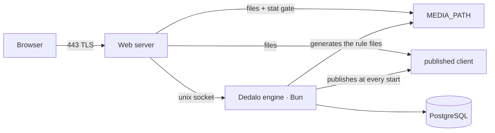

# The web server site

> See also: [Production install](production.md) · [Media protection](../config/media_protection.md) · [Troubleshooting](troubleshooting.md) · [H.264 streaming module](install_h264_module.md)

Dédalo's engine listens on a **unix socket and nothing else**. The web server in front of it is not an optional performance layer: it owns TCP and TLS, it serves the client files, and — most importantly — **it is what enforces media access control**. On the Production route the installer writes the site for you; this page explains what it writes and why, as reference for system administrators, and how to write a site by hand on a host [installed by hand](manual_install.md).

## What the web server is responsible for



| URL space | Served by | Notes |
| --- | --- | --- |
| `/health` | **web server → socket** | the liveness probe, at the origin root; the browser's maintenance widget and the post-update restart poll probe it there |
| `/api/v1/…`, `/dedalo/core/api/…` | **web server → socket** | the JSON API, uploads, the raw/environment/counters views — rate-limited per source address, unbuffered |
| `/dedalo/lib/…` | **web server → socket** | third-party browser libraries, served through an allowlist |
| `/dedalo/tools/…`, `/dedalo/core/tools_common/…` | **web server → socket** | tool assets live in the tool trees, outside the client |
| `/dedalo/core/component_text_area/tag/` | **web server → socket** | the inline-tag image factory |
| `/dedalo/install/import/ontology/…` | **web server → socket** | only when this instance is an ontology master |
| `/dedalo/install/code/…` | **web server → socket** | the release archives a code master serves |
| `/dedalo/install/import/hierarchy/…` | **web server → socket** | hierarchy export downloads (admin-session-gated) |
| `/dedalo/ai_models/…` | **web server → socket** | the local AI model store; session-gated |
| `/dedalo/upload_tmp/…` | **web server → socket** | staged-upload previews, before the record is saved |
| `/dedalo/export/artifact/…` | **web server → socket**, unbuffered | tool_export's built files; owner-only, session-gated, often many gigabytes |
| `/dedalo/media/…` | **web server, from `MEDIA_PATH`** | gated by the generated rules — see below |
| everything else under `/dedalo/…` | **web server, from the published client** | static files, revalidated (`Cache-Control: no-cache`) |

!!! warning "Never proxy media through the engine"
    Media files reach tens of gigabytes. Authorisation is one `stat()` performed by the web server itself, which is why `sendfile`, HTTP `Range` and the H.264 `?start=` clipping keep working. Put the engine in the byte path and you break streaming, seeking and memory headroom in one move. (The engine has a media route for developers with no web server in front. It applies **no per-record access control** and answers only on the TCP development listener while protection is unconfigured — so behind a web server, on the socket, it never runs. Leave `MEDIA_DEV_ROUTE_ENABLED` unset.)

## What the installer writes

The `host_web_http` and `host_web_site` steps write **one site file** for the instance, and never another site, the default site or the global configuration:

| Web server | Site file |
| --- | --- |
| nginx | `/etc/nginx/conf.d/dedalo-<i>.conf` |
| Apache (Debian, Ubuntu) | `/etc/apache2/sites-available/dedalo-<i>.conf`, enabled with `a2ensite` |
| Apache (RHEL family) | `/etc/httpd/conf.d/dedalo-<i>.conf` |

It is rendered from the routes of the shipped reference configurations (`deploy/nginx.conf`, `deploy/apache.conf`), with:

- **every name made the instance's own** — the nginx `upstream dedalo_<i>`, the rate-limit zone `dedalo_<i>_api`, the log files `dedalo-<i>.*.log` — so two instances on one host never share a name;
- **the instance's paths** — the socket `/run/dedalo-<i>/dedalo_ts.sock`, the client the engine publishes at `/srv/dedalo/<i>/client` (the web server never reads the code tree), the site's `root /srv/dedalo/<i>`;
- **the certificate** — `/etc/letsencrypt/live/dedalo-<i>/` for Let's Encrypt, or your institution's files where they are;
- `http2 on;` (nginx 1.25.1 or newer), `server_tokens off`, and the security headers (`Strict-Transport-Security`, `X-Content-Type-Options`, `X-Frame-Options`, `Referrer-Policy`) in every location that sets its own headers.

Before every reload the configuration is tested, and a failed test puts the files back as they were. A reload applies every pending change of the web server's configuration, not only this site's, which the Review says next to the command.

### nginx: validated copies of the media rules

nginx's master process parses every included file as root, and `MEDIA_PATH` belongs to the instance user. Including the engine's generated files from there would let the web-facing engine write root-parsed configuration. So the site **never includes a file the instance can write**: `/opt/dedalo/instances/<i>/bin/dedalo-media-rules.sh` copies the generated rules — validated line by line against the forms the engine writes — to the root-owned `/etc/nginx/dedalo/<i>/`, and the site includes the copies.

The media map's variables are global to nginx, so exactly one instance's map copy is included host-wide, by `/etc/nginx/conf.d/dedalo-00-media-map.conf`. An instance whose map differs (another release) is refused: keep same-host instances at the same release. After you change the media access mode, refresh the copies — [Production › Changing the media access mode](production.md#changing-the-media-access-mode).

### Apache: the `.htaccess` gate

On Apache the generated `.htaccess` inside `MEDIA_PATH` is the gate. The site allows only the overrides it uses (`AuthConfig FileInfo Options=Indexes,ExecCGI`, never `All`) and turns directory listing and CGI off again after it. The installer **checks** the modules the site needs (`ssl headers http2 rewrite proxy proxy_http`) and never enables one: when one is missing it stops with the exact command, and you run it and resume.

## How the media gate decides

**Rule A — the back-office cookie.** When a user logs in, the engine sets a fixed-name cookie, `dedalo_media_auth`, whose value rotates daily and is also written as a zero-byte marker under `<media>/.publication/auth/`. The web server authorises a request by checking that the file named by the cookie exists. Today's and yesterday's values are both valid, so nobody is logged out of media at midnight.

**Rule B — the publication markers** (`publication` mode only). An anonymous visitor may read a file only when it sits in a **public quality folder** and its record is **published**. The record identity is parsed from the *file name* (`…{component_tipo}_{section_tipo}_{section_id}[_lg-xxx].{ext}`), and the web server checks for a marker at `<media>/.publication/pub/{section_tipo}_{section_id}`, maintained by the diffusion engine.

The gate fails closed as `404`, never `403`, and the marker store itself is never served. The whole subsystem is defined in `engineering/MEDIA_PROTECTION.md`; the administrator view is [media protection](../config/media_protection.md).

### The generated rule files

The **engine generates** the web-server rules; the **web server enforces** them. The files are written into `MEDIA_PATH` at boot, at every login, and by the `media_control` maintenance widget — idempotently, guarded by a config hash embedded in each file.

| Generated file (in `MEDIA_PATH`) | Web server | Included |
| --- | --- | --- |
| `.htaccess` | Apache | read by Apache on every request, where the directory allows overrides |
| `dedalo_media_protection.nginx.conf` | nginx | in the media `server{}` |
| `dedalo_media_protection_map.nginx.conf` | nginx | at `http{}` scope |

!!! danger "Both nginx includes, or none"
    The map file defines `$dedalo_auth_key`, and a `map` cannot live inside `server{}`. Include the server file without the map and **nginx refuses to start** (`unknown "dedalo_auth_key" variable`). That is deliberate: a half-wired gate must never boot half-open.

    On a publication host provisioned with `provision init`, the `http{}` map is pushed by **Apply media rules** into the host-wide include and must not be placed by hand. See [publication host agent](publication_host.md#9-map-the-apis-into-the-sites-virtual-host).

!!! note "Reloads: what needs one and what does not"
    - **A mode change needs an nginx reload** of fresh copies (above). Apache re-reads `.htaccess` on every request and needs nothing.
    - **The daily cookie rotation needs no reload, ever.** That is why the cookie *name* is fixed and only its *value* rotates: the rules never name a value, they only test whether the file named by the cookie exists.

### Media without access control

An internal instance, or one whose media is public by policy, can serve the media tree openly: set the media access mode to `false`. The engine then writes no rule files, and the installer's site serves `/dedalo/media/` as an open location, with a comment saying so.

!!! danger "Open means open"
    No login is required and no per-record or per-project rule applies: anyone who can reach the server reads every image, document and recording. Decide this deliberately for the collection you actually hold — a restricted fonds, an embargoed deposit or personal data makes it the wrong choice.

### The root rule

**The generated nginx locations carry no `root` and no `alias`.** They inherit the server's `root`, so the server `root` must satisfy:

```text
<root> + /dedalo/<media directory>/…   ==   MEDIA_PATH/…
```

On a production instance that is `root /srv/dedalo/<i>;` with `MEDIA_PATH=/srv/dedalo/<i>/dedalo/media` — which is why the installer refuses a production `MEDIA_PATH` that does not end in `/dedalo/media`.

!!! warning "Get this wrong and the symptom lies to you"
    A mismatched root produces a `404` on every media file *while the access gate itself is working perfectly*. It looks like a permissions problem and it is not. Test it against a file you know exists.

Apache has no such subtlety: an `Alias` maps the URL onto `MEDIA_PATH` directly.

## The settings that bite

| Setting | Value | What breaks otherwise |
| --- | --- | --- |
| read timeout | **≥ `SERVER_IDLE_TIMEOUT_S`** (255 s; the site uses 300 s) | a large export or a long tool action is killed by the web server one hop before the engine would have finished it |
| response buffering | **off** on the API location | the assistant chat (SSE), diffusion progress and NDJSON exports stall or die |
| request rate | **`limit_req` on the API location** (nginx; on Apache, `mod_ratelimit` or `mod_evasive`) | nothing bounds how fast one source may call the API; the engine's login throttle is per account |
| max request body | **≥ 256 MiB** (nginx `client_max_body_size`, 300 MB in the site; Apache's default is unlimited) | every upload fails with `413` — nginx's default is 1 MB, and the client uploads in ~4 MB chunks |
| `TRUSTED_PROXY_HOPS` | **the number of proxies that append `X-Forwarded-For`** (default `1`) | the login throttle keys on the wrong address |
| `open_file_cache` | **off** on the media locations | unpublishing a record does not take effect until the cache expires |
| socket permissions | `UMask=0007` in the unit, the web server's user in the instance group | `502` on every request — connecting to a unix socket needs **write** permission on it |

TLS is a hard requirement: `SESSION_COOKIE_SECURE` defaults to **true**, so a browser does not store the session cookie over plain HTTP and **nobody can log in**. The media-auth cookie carries the same attributes.

## Verify

```shell
# The engine answers over the socket, and PostgreSQL is reachable.
curl --fail --unix-socket /run/dedalo-<i>/dedalo_ts.sock http://localhost/health

# The same probe THROUGH the web server — the surface the browser client uses.
curl --fail https://dedalo.example.org/health

# The web server serves the client over TLS.
curl -I https://dedalo.example.org/dedalo/core/page/

# A media file honours Range (206 — proof that nothing is in the byte path).
curl -I -H 'Range: bytes=0-99' https://dedalo.example.org/dedalo/media/image/thumb/<a-real-file>.jpg

# The marker store is never served (404).
curl -I https://dedalo.example.org/dedalo/media/.publication/auth/
```

A `/health` that is green over the socket but `404`s or `403`s through the domain means the site is missing its `/health` route: the engine is fine, and only the browser-facing checks can see the difference. A `Range` request that answers `200` with a full body — instead of `206` — means something has been put in the media byte path.

## A site written by hand

A host [installed by hand](manual_install.md) writes the installer's own site file, printed in full in [`host_web_site`](manual_install.md#manual-host_web_site). The reference configurations below, `deploy/nginx.conf` and `deploy/apache.conf`, are for a host on [the single-unit set](manual_install.md#the-single-unit-set) of before 2026-10-12, with its single-instance layout (`MEDIA_PATH=/srv/dedalo/media`, so `root /srv;`). Obtain the certificate with your distribution's `certbot` (`certbot certonly --webroot`, as the installer does) or use your institution's.

!!! warning "The hand-written nginx site includes the generated files directly"
    The reference `deploy/nginx.conf` includes the rule files from `MEDIA_PATH`, a directory the service user writes, which nginx's master parses as root. The installer avoids this with validated root-owned copies ([above](#nginx-validated-copies-of-the-media-rules)); on a hand-written site, `deploy/dedalo-media-rules.sh` can maintain the same copies.

### nginx

The two media `include` lines point at files the engine writes on its **first boot**, so they ship commented out. Install the configuration as shown, start the engine once, check that `MEDIA_PATH` holds `dedalo_media_protection.nginx.conf` and `dedalo_media_protection_map.nginx.conf`, then uncomment **both** lines and `nginx -t && systemctl reload nginx`. Until then media is not served at all — the safe failure.

```nginx
# --- http{} scope (a conf.d file is already inside http{}) -------------------
# include /srv/dedalo/media/dedalo_media_protection_map.nginx.conf;   # ← uncomment after the first boot

upstream dedalo_ts {
	server unix:/run/dedalo/dedalo_ts.sock;
}

# Request-rate ceiling for the API door, per source address. The engine bounds
# what one request may carry; this bounds how many arrive, and it costs the
# engine nothing because nginx refuses before the proxy hop. `nodelay` releases
# the burst immediately — a page load fans out into a dozen parallel component
# reads, so a burst is normal and only a flood is refused.
limit_req_zone $binary_remote_addr zone=dedalo_api:10m rate=20r/s;

server {
	listen 80;
	server_name dedalo.example.org;
	return 301 https://$host$request_uri;
}

server {
	listen 443 ssl;
	http2 on;                       # multiplexes the 36-module client boot graph
	server_name dedalo.example.org;

	ssl_certificate     /etc/letsencrypt/live/dedalo.example.org/fullchain.pem;
	ssl_certificate_key /etc/letsencrypt/live/dedalo.example.org/privkey.pem;
	ssl_protocols       TLSv1.2 TLSv1.3;

	root /srv;                      # THE ROOT RULE — see above
	client_max_body_size 300m;      # nginx defaults to 1m; every upload would 413

	add_header Strict-Transport-Security "max-age=31536000; includeSubDomains" always;
	add_header X-Content-Type-Options    "nosniff"    always;
	add_header X-Frame-Options           "SAMEORIGIN" always;
	add_header Referrer-Policy           "strict-origin-when-cross-origin" always;

	# Media — the GENERATED gate (written on first boot). Uncomment after the first boot.
	# include /srv/dedalo/media/dedalo_media_protection.nginx.conf;
	open_file_cache off;            # a stat() cache delays an unpublish

	# Liveness probe. The engine serves its health check at the ORIGIN ROOT
	# `/health`. The watchdog hits it over the unix socket, but the browser-facing
	# system_info maintenance widget probes it over HTTP too, so it must be
	# reachable here — otherwise the catch-all `location / { 404 }` below swallows
	# it and the widget reports a healthy engine as down.
	location = /health {
		proxy_pass http://dedalo_ts;
		proxy_http_version 1.1;
		proxy_set_header Host $host;
	}

	# API + dynamic routes. A regex location outranks every prefix location, so
	# this keeps precedence over the /dedalo/ static alias below.
	location ~ ^/(api/v1/|dedalo/core/api/) {
		limit_req zone=dedalo_api burst=40 nodelay;
		proxy_pass http://dedalo_ts;
		proxy_http_version 1.1;
		proxy_set_header Host              $host;
		proxy_set_header X-Forwarded-For   $proxy_add_x_forwarded_for;
		proxy_set_header X-Forwarded-Proto $scheme;
		proxy_read_timeout 300s;    # >= SERVER_IDLE_TIMEOUT_S (255)
		proxy_send_timeout 300s;
		proxy_buffering off;        # SSE + NDJSON streaming
	}

	# Dynamic routes that live under /dedalo/ but are NOT static files. No client
	# subtree answers any of them, so an omitted line does not fall back to the
	# engine — the alias below serves a 404 and the request never reaches the
	# socket. The last three are conditional on what this install does (code
	# master, hierarchy export, in-browser AI) and 404 harmlessly otherwise.
	location /dedalo/lib/                            { proxy_pass http://dedalo_ts; }
	location /dedalo/tools/                          { proxy_pass http://dedalo_ts; }
	location /dedalo/core/tools_common/              { proxy_pass http://dedalo_ts; }
	location = /dedalo/core/component_text_area/tag/ { proxy_pass http://dedalo_ts; }
	location /dedalo/install/import/ontology/        { proxy_pass http://dedalo_ts; }
	location /dedalo/install/code/                   { proxy_pass http://dedalo_ts; }
	location /dedalo/install/import/hierarchy/       { proxy_pass http://dedalo_ts; }
	location /dedalo/ai_models/                      { proxy_pass http://dedalo_ts; }
	location /dedalo/upload_tmp/                     { proxy_pass http://dedalo_ts; }
	location /dedalo/export/artifact/                { proxy_buffering off; proxy_pass http://dedalo_ts; }

	# Client static files. Served IN PLACE (not content-hashed) — they must
	# revalidate, so they are NEVER immutable.
	location /dedalo/ {
		alias /opt/dedalo/master_dedalo/client/dedalo/;
		etag on;
		add_header Cache-Control "no-cache";
		gzip on;
		gzip_types text/css application/javascript application/json image/svg+xml;
		gzip_min_length 1024;
		location ~* \.(png|jpe?g|gif|webp|ico|woff2?|ttf|otf)$ {
			add_header Cache-Control "public, max-age=3600";
		}
	}

	location = / { return 302 /dedalo/core/page/; }
	location   / { return 404; }
}
```

!!! note "Several domains on one box"
    This is a single-domain vhost. To serve more domains, add one `upstream` and one `server{}` per domain, each pointing at that instance's socket and `MEDIA_PATH` — see [Several instances by hand](manual_install.md#several-instances-by-hand).

!!! note "The rule-B location regex is double-quoted, and must stay so"
    In `publication` mode the generated `dedalo_media_protection.nginx.conf` writes its rule-B location as a **quoted** regex, because the pattern contains `{2,12}` and nginx's configuration lexer treats `{` and `}` as block delimiters. Unquoted, nginx refuses to start:

    ```text
    nginx: [emerg] pcre2_compile() failed: missing closing parenthesis in "^/dedalo/media/(?:…"
    ```

    Files generated before 2026-07-12 were written unquoted, and the file is only rewritten when its embedded `# config-hash:` line stops matching the current configuration. If you see this error, wrap that one regex in double quotes; quoting does not change the hash, so the edit survives:

    ```nginx title="fix"
    location ~ "^/dedalo/media/(?:av/404|…)…$" {
    ```

    If you copy the rules into a hand-written config, keep the quotes.

### Apache

The reference vhost is **`deploy/apache.conf`**. Enable the modules, copy it, and adjust the names and paths. The `ProxyPass` rules must come **before** the aliases, and `Alias /dedalo/media` must come before `Alias /dedalo`: the first match wins. The abridged shape:

```shell
a2enmod ssl headers http2 rewrite proxy proxy_http
```

```apache
<VirtualHost *:80>
    ServerName dedalo.example.org
    Redirect permanent / https://dedalo.example.org/
</VirtualHost>

<VirtualHost *:443>
    ServerName dedalo.example.org
    Protocols h2 http/1.1

    SSLEngine on
    SSLCertificateFile    /etc/letsencrypt/live/dedalo.example.org/fullchain.pem
    SSLCertificateKeyFile /etc/letsencrypt/live/dedalo.example.org/privkey.pem
    Include /etc/letsencrypt/options-ssl-apache.conf

    ProxyPreserveHost On
    # >= SERVER_IDLE_TIMEOUT_S (255). Apache honours `#` only at the start of a
    # line — a comment appended to a directive is parsed as an argument.
    ProxyTimeout 300

    # --- Liveness probe → the unix socket ---------------------------------
    # The engine serves /health at the ORIGIN ROOT and the browser client
    # probes it there. Omit this and Apache resolves /health against the
    # DocumentRoot and denies it (AH01630), so the maintenance widget reports
    # a healthy engine as down and the post-update restart poll never confirms.
    ProxyPass        /health unix:/run/dedalo/dedalo_ts.sock|http://localhost/health
    ProxyPassReverse /health unix:/run/dedalo/dedalo_ts.sock|http://localhost/health

    # --- API + dynamic routes → the unix socket ---------------------------
    ProxyPass /api/v1/                              unix:/run/dedalo/dedalo_ts.sock|http://localhost/api/v1/
    ProxyPass /dedalo/core/api/                     unix:/run/dedalo/dedalo_ts.sock|http://localhost/dedalo/core/api/
    ProxyPass /dedalo/lib/                          unix:/run/dedalo/dedalo_ts.sock|http://localhost/dedalo/lib/
    ProxyPass /dedalo/tools/                        unix:/run/dedalo/dedalo_ts.sock|http://localhost/dedalo/tools/
    ProxyPass /dedalo/core/tools_common/            unix:/run/dedalo/dedalo_ts.sock|http://localhost/dedalo/core/tools_common/
    ProxyPass /dedalo/core/component_text_area/tag/ unix:/run/dedalo/dedalo_ts.sock|http://localhost/dedalo/core/component_text_area/tag/
    ProxyPass /dedalo/install/import/ontology/      unix:/run/dedalo/dedalo_ts.sock|http://localhost/dedalo/install/import/ontology/
    ProxyPass /dedalo/install/code/                 unix:/run/dedalo/dedalo_ts.sock|http://localhost/dedalo/install/code/
    ProxyPass /dedalo/install/import/hierarchy/     unix:/run/dedalo/dedalo_ts.sock|http://localhost/dedalo/install/import/hierarchy/
    ProxyPass /dedalo/ai_models/                    unix:/run/dedalo/dedalo_ts.sock|http://localhost/dedalo/ai_models/
    ProxyPass /dedalo/upload_tmp/                   unix:/run/dedalo/dedalo_ts.sock|http://localhost/dedalo/upload_tmp/
    ProxyPass /dedalo/export/artifact/              unix:/run/dedalo/dedalo_ts.sock|http://localhost/dedalo/export/artifact/

    # --- Entry points: the client tree has no index.html above core/page/ --
    RedirectMatch 302 "^/dedalo/?$"      /dedalo/core/page/
    RedirectMatch 302 "^/dedalo/core/?$" /dedalo/core/page/
    RedirectMatch 302 "^/$"              /dedalo/core/page/

    # --- Media: the generated .htaccess lives inside MEDIA_PATH -----------
    Alias /dedalo/media /srv/dedalo/media
    <Directory /srv/dedalo/media>
        # WITHOUT AllowOverride the generated .htaccess is ignored — silently,
        # and OPEN. This single line is the whole media gate on Apache.
        AllowOverride All
        Options -Indexes -ExecCGI
        Require all granted
    </Directory>

    # --- Client static files ----------------------------------------------
    Alias /dedalo /opt/dedalo/master_dedalo/client/dedalo
    <Directory /opt/dedalo/master_dedalo/client/dedalo>
        Options -Indexes
        AllowOverride None
        Require all granted
    </Directory>

    Header always set Strict-Transport-Security "max-age=31536000; includeSubDomains"
    Header always set X-Content-Type-Options "nosniff"
    Header always set X-Frame-Options "SAMEORIGIN"
</VirtualHost>
```

!!! danger "Overrides on the media directory are not a style choice"
    Apache reads the generated `.htaccess` only if the directory allows overrides. Without them the file is ignored **silently**, and the whole media tree — originals included — is world-readable. `mod_rewrite` must be enabled for the same reason. The installer's site allows only the overrides the file uses; `AllowOverride All` works too, with a wider grant.

Serving audiovisual fragments by time range needs an extra Apache module; nginx has the equivalent built in. See [H.264 streaming module](install_h264_module.md).
